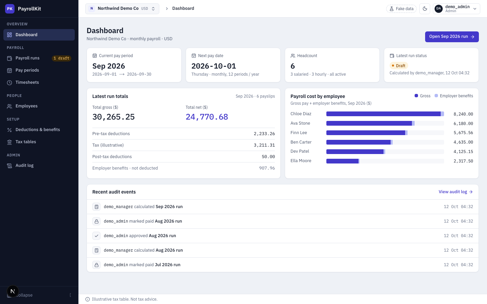
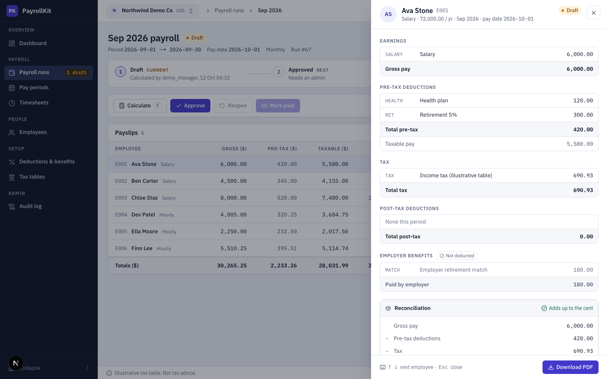
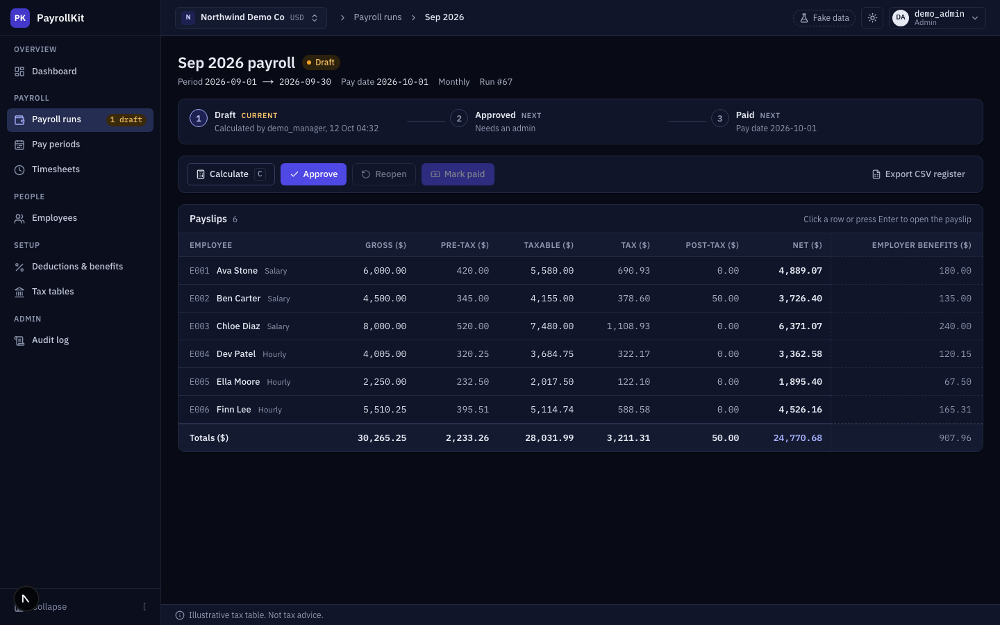
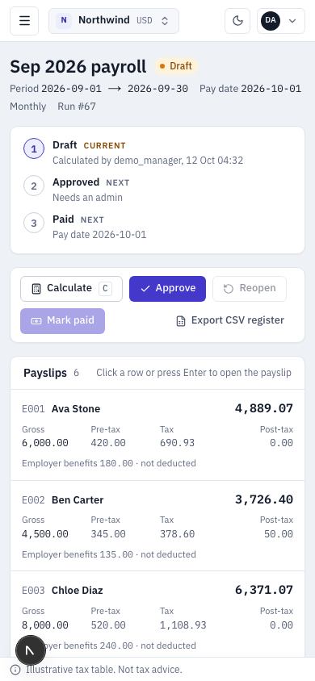

# PayrollKit UI

The web app for [PayrollKit API](https://github.com/oktoberlin/payroll-kit): payroll runs, payslips, approvals and an audit trail, in a dense, accessible admin interface with light and dark themes.

> **Demo project.** All data is fake and the tax tables are **illustrative only, not tax advice**.


|  |  |
|---|---|
|  |  |
|  |  |

## Try it

- Live: `https://payroll.hookangles.com`
- Sign in with one click as any demo account (password `demo-pass-123`):

| User | Role | What it shows |
|---|---|---|
| `demo_admin` | Admin | Calculate, approve, reopen, mark paid, audit log |
| `demo_manager` | Payroll manager | Everything except approval; Approve / Mark paid are disabled with "Admin only" |
| `demo_employee` | Employee | Only their own approved and paid payslips, with PDFs |

A 2-minute tour: sign in as `demo_admin` → **Payroll runs** → open **Sep 2026** → **Calculate** (twice: the second time nothing changes) → click a payslip → **Approve** → **Mark paid** → the run locks → **Audit log**.

## What it demonstrates

- **Money is never a float.** Amounts stay decimal strings from the API to the screen; grouping and sums use exact BigInt arithmetic. Every payslip shows its own proof that it adds up to the cent.
- **Workflow you can trust.** Draft → Approved → Paid, with confirmation dialogs that state the consequence, a stale-inputs banner that blocks approval, and a locked, read-only state once paid.
- **Role-aware, not role-hidden.** A manager sees the Approve button disabled with a reason instead of missing; employees get a separate, minimal self-service area. The API enforces all of it again.
- **Secure by construction.** JWTs live in httpOnly cookies set by the Next.js server, never in browser JavaScript. The browser only talks to its own origin; a proxy attaches the token, refreshes it, and forwards the real client IP (with a shared secret) so the API's rate limiting works behind Vercel.
- **Accessible.** WCAG A/AA axe scans run in CI on every main screen in both themes; keyboard navigation (`C` calculates, `↑ ↓ Esc` in the payslip drawer, `[` collapses the sidebar), visible focus, status never colour alone.
- **Typed end to end.** API types are generated from the API's OpenAPI schema (`npm run gen:api`).

## Stack

Next.js 15 (App Router), React 19, TypeScript, Tailwind CSS 3.4 on a small design system (CSS-variable tokens, IBM Plex Sans/Mono, lucide icons), TanStack Query, Vitest, Playwright + axe.

## Run it locally

```bash
# 1. the API (from the payroll-kit repo)
python manage.py migrate && python manage.py seed_demo
DJANGO_DEBUG=1 python manage.py runserver 127.0.0.1:8000

# 2. this app
cp .env.example .env.local     # API_ORIGIN defaults to http://127.0.0.1:8000
npm install
npm run dev                    # http://localhost:3040
```

| Script | |
|---|---|
| `npm run typecheck` / `lint` / `test` | TypeScript, ESLint, unit tests (money, validation, audit, payslip logic) |
| `npm run gen:api` | Regenerate `lib/api-types.ts` from the running API |
| `npm run test:e2e` | Browser tests against the API (see below) |

### End-to-end tests

They drive real browsers against the real API, including paying a run, so they reseed the demo data first:

```bash
# API with relaxed rate limits (the suite signs in a lot)
DJANGO_DEBUG=1 THROTTLE_TOKEN=1000/min THROTTLE_ANON=1000/min python manage.py runserver 127.0.0.1:8000
E2E_BACKEND_DIR=../payroll-kit npm run test:e2e
```

39 tests cover: the three roles, the full run lifecycle, error states (409, duplicate numbers, all-or-nothing CSV import, tax bracket rules), session expiry, phone layouts and the accessibility scans. CI runs them against the API repo on every push.

## Deploy

Vercel project from this repo. Environment variables:

| Variable | Value |
|---|---|
| `API_ORIGIN` | `https://api.payroll.hookangles.com` |
| `PROXY_IP_SECRET` | the same value as the API's `PROXY_IP_SECRET` |

Then attach `payroll.hookangles.com` to the project. The API needs no CORS configuration: the browser never calls it directly.

## Design

The UI is built from a Claude Design prototype kept in [`design/`](design/prototype-design-system) (tokens, component sheet, 40+ screen frames in light, dark and 390px). Where the prototype was silent (deduction-type form, add employee, new tax table, delete confirmations) the screens reuse the same components.
